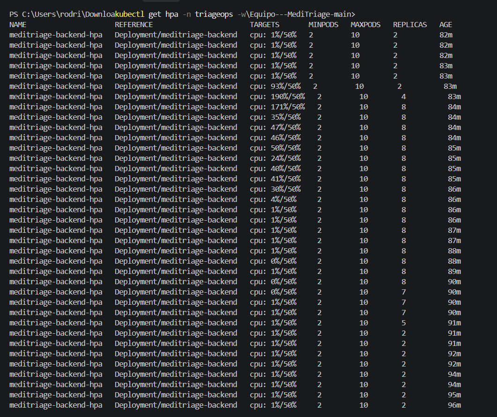
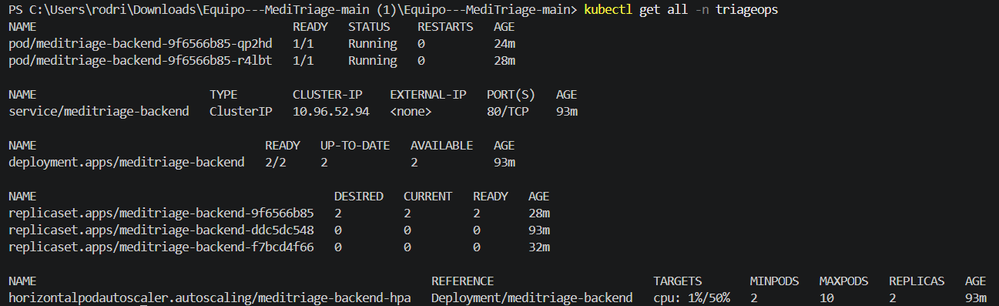

# Equipo---MediTriage

## 🛠️ Configuración del Entorno de Desarrollo Local

Sigue estos pasos para clonar el repositorio, configurar el entorno virtual de Python e instalar las dependencias necesarias para trabajar en el backend.

### Prerrequisitos

* **Git** instalado en el sistema.
* **Python 3.11+** instalado (asegúrate de marcar la casilla *"Add Python to PATH"* durante la instalación).

---

### 1. Clonar el Repositorio

Abre tu terminal y clona el proyecto:

```bash
git clone <URL_DEL_REPOSITORIO>
cd Equipo---MediTriage
```

---

### 2. Navegar al Backend

Toda la lógica y dependencias de la API residen en la carpeta backend:

```bash
cd backend
```

---

### 3. Crear el Entorno Virtual

Crea un entorno virtual aislado para evitar conflictos de librerías:

#### En Windows (PowerShell / CMD):

```powershell
python -m venv venv
```

#### En macOS / Linux:

```bash
python3 -m venv venv
```

---

### 4. Activar el Entorno Virtual

#### En Windows (PowerShell):

```powershell
.\venv\Scripts\Activate.ps1
```
*(Nota: Si PowerShell arroja un error de ejecución de scripts, ejecuta primero `Set-ExecutionPolicy -Scope Process -ExecutionPolicy Bypass` y vuelve a intentar).*

#### En Windows (Git Bash):

```bash
source venv/Scripts/activate
```

#### En macOS / Linux:

```bash
source venv/bin/activate
```

Sabrás que está activo porque aparecerá `(venv)` al inicio de la línea en tu terminal.

---

### 5. Instalar Dependencias

Actualiza el gestor de paquetes e instala las librerías del proyecto:

```bash
python -m pip install --upgrade pip
pip install -r requirements.txt
```

---

### 6. Ejecutar el Servidor en Modo Desarrollo (HTTP Base)

Inicia el servidor local con recarga automática:

```bash
uvicorn app.main:app --reload --port 8000
```

* **API Base:** `http://localhost:8000`
* **Health Check:** `http://localhost:8000/api/v1/health`
* **Documentación Interactiva (Swagger):** `http://localhost:8000/docs`

---

### 7. Ejecutar Pruebas Automatizadas

Para validar que todo funciona correctamente y comprobar la cobertura de código:

```bash
pytest
```

---

## 🔒 Configuración de Seguridad y TLS (DevSecOps)

Una vez completados los pasos de instalación base, es obligatorio configurar el entorno de desarrollo local con conexiones cifradas (HTTPS/TLS) para cumplir con los estándares del proyecto.

### 1. Protección de Base de Datos y PII
*   **Cifrado de Datos (PII):** La base de datos tiene habilitada la extensión `pgcrypto` para encriptar campos de información personal.
*   **Conexión TLS requerida:** La variable `DATABASE_URL` en el archivo `docker-compose.yml` ya incluye el parámetro `?sslmode=require`. Esto obliga a que la comunicación entre la API y PostgreSQL viaje completamente encriptada.

### 2. Generar Certificados Locales para la API
Para que la API corra bajo HTTPS en local, instala `mkcert` (abre PowerShell como administrador para esta primera vez):

```powershell
winget install mkcert
mkcert -install
```

Luego, abre una terminal normal, asegúrate de estar en la carpeta del backend y genera tus llaves de seguridad:

```powershell
cd backend
mkcert localhost 127.0.0.1
```
*(Nota: Se crearán los archivos `localhost+1.pem` y `localhost+1-key.pem`. Estos nunca deben subirse al repositorio).*

### 3. Levantar el Servidor Seguro (HTTPS)
En lugar del comando del paso 6, arranca el servidor apuntando a las llaves que acabas de crear:

```powershell
uvicorn app.main:app --reload --ssl-keyfile="localhost+1-key.pem" --ssl-certfile="localhost+1.pem"
```
✅ **Verificación:** Ingresa a `https://127.0.0.1:8000/docs`. Deberás ver el candado cerrado en el navegador, confirmando que tu entorno seguro está activo.

## 🔒 Prohibición de Mocks Locales (Dev/prod parity)

Para mantener la consistencia entre los entornos de desarrollo y producción, es obligatorio utilizar los servicios reales definidos en `docker-compose.yml` durante el desarrollo integrado de MediTriage.

### 1. Uso obligatorio de servicios reales

* **PostgreSQL:** Se prohíbe utilizar SQLite o bases de datos en memoria como reemplazo de PostgreSQL.
* **Redis:** Se prohíbe sustituir Redis por diccionarios, variables globales u otros mecanismos de almacenamiento local.
* **Servicios simulados:** No se deben utilizar implementaciones simuladas que oculten errores de conexión o diferencias de comportamiento durante el desarrollo integrado.

### 2. Configuración del entorno de desarrollo

Todos los integrantes del equipo deben utilizar los servicios reales definidos en `docker-compose.yml`, manteniendo una configuración consistente con la infraestructura del proyecto.

Para iniciar los servicios, ejecutar desde la carpeta raíz del proyecto:

```bash
docker compose up -d --build
```

Para verificar el estado de los contenedores:

```bash
docker compose ps
```

Para consultar los registros de ejecución:

```bash
docker compose logs -f
```

### 3. Verificación de PostgreSQL y Redis

Antes de comenzar el desarrollo o las pruebas de integración, se debe comprobar que los servicios estén disponibles.

Para verificar PostgreSQL:

```bash
docker compose exec postgres pg_isready
```

Para verificar Redis:

```bash
docker compose exec redis redis-cli ping
```

✅ **Verificación:** Redis debe responder `PONG` y PostgreSQL debe indicar que acepta conexiones. Los nombres `postgres` y `redis` deben coincidir con los servicios definidos en `docker-compose.yml`.

### 4. Manejo de errores de conexión

* **Variables de entorno:** Verificar que `DATABASE_URL` y `REDIS_URL` tengan los valores correctos.
* **Contenedores:** Comprobar que los servicios estén en ejecución.
* **Configuración:** Revisar credenciales, puertos y redes de Docker Compose.
* **Corrección de errores:** Los problemas de conexión deben solucionarse en el entorno integrado, sin sustituir PostgreSQL por SQLite ni Redis por almacenamiento en memoria.

### 5. Uso de mocks en pruebas

Los mocks pueden utilizarse en pruebas unitarias aisladas cuando sea necesario verificar componentes específicos. Sin embargo, no deben reemplazar PostgreSQL ni Redis durante el desarrollo integrado de MediTriage.

✅ **Criterio de cumplimiento:** Todo el equipo debe ejecutar la aplicación utilizando los servicios reales definidos en `docker-compose.yml`, evitando diferencias de comportamiento entre desarrollo y producción.

---

## 🧪 Servidor Mock de la API (Prism)

Para levantar un servidor mock local basado en el contrato OpenAPI de MediTriage y probar los endpoints antes de desplegar el backend:

```bash
npx @stoplight/prism-cli mock api/openapi.yaml -p 4010
```

---

## Autoescalado (HPA)

El backend se despliega con Kustomize y escala automáticamente según el uso de CPU (mínimo 2 réplicas, máximo 10, objetivo 50%).

Aplicar los manifiestos:

```bash
kubectl apply -k k8s/
```

Probar el HPA con carga sintética (script en `scripts/load/hpa-load.sh`):

```bash
kubectl get hpa -n triageops -w
kubectl run carga -n triageops --rm -it --image=busybox:1.36 --restart=Never -- sh -c "for i in 1 2 3 4 5; do (while true; do wget -q -O- http://meditriage-backend/api/v1/health >/dev/null; done) & done; wait"
```

### Evidencia

En la prueba el HPA subió de 2 a 8 réplicas bajo carga y volvió a 2 al cortarla. Los registros del estado antes, durante y después están en `docs/evidencia-hpa/`: `01-antes.txt`, `02-durante.txt` y `03-despues.txt`.

Cambio de réplicas durante la prueba:



Estado final del namespace (`kubectl get all -n triageops`):


